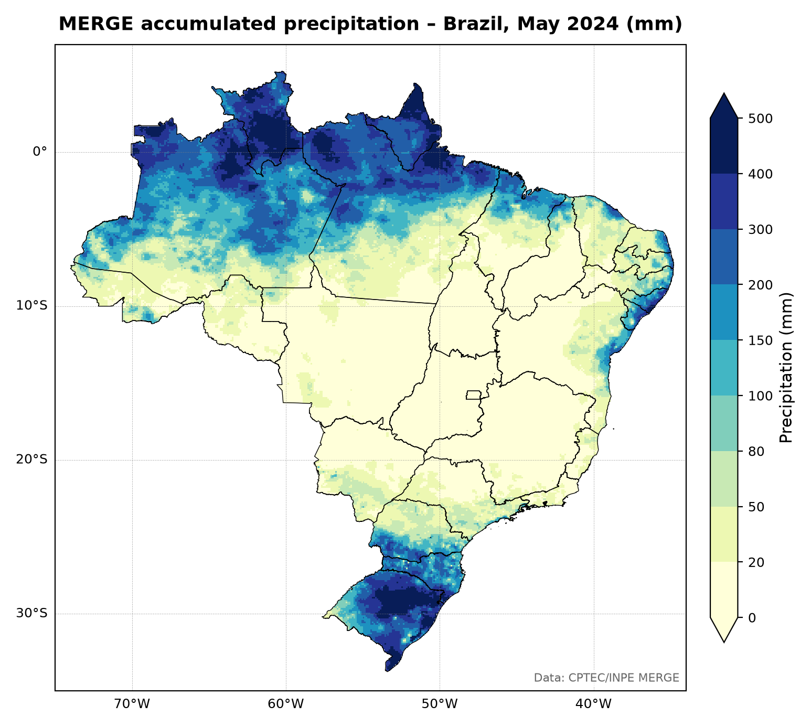
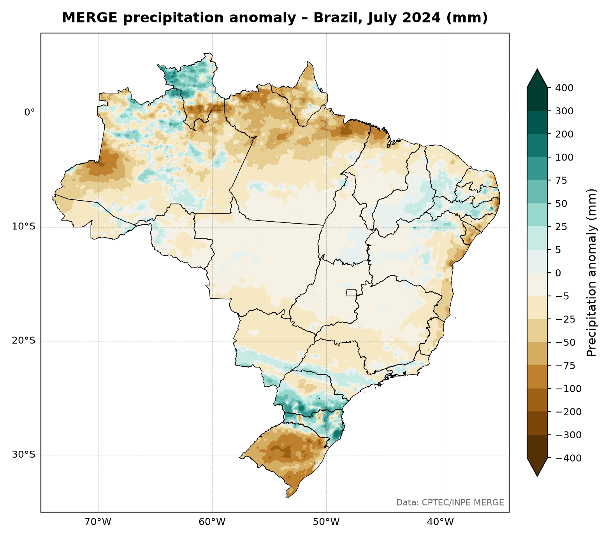
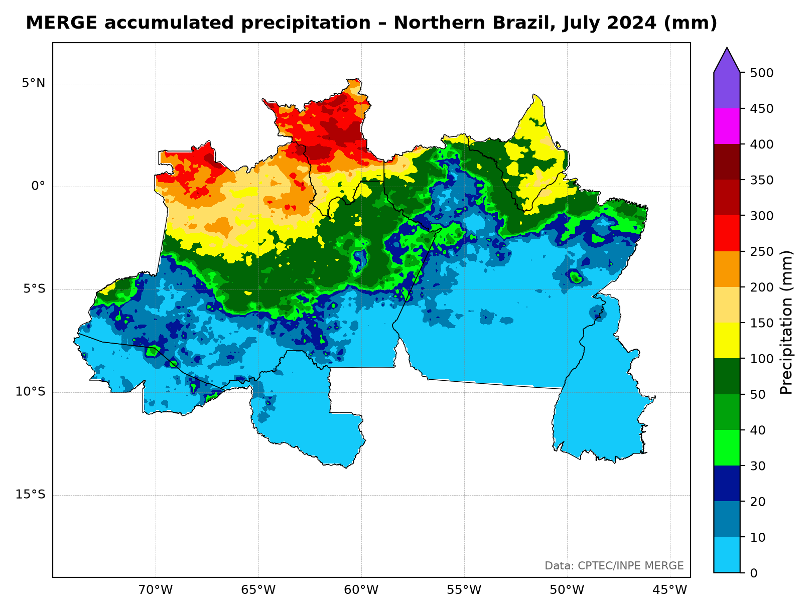
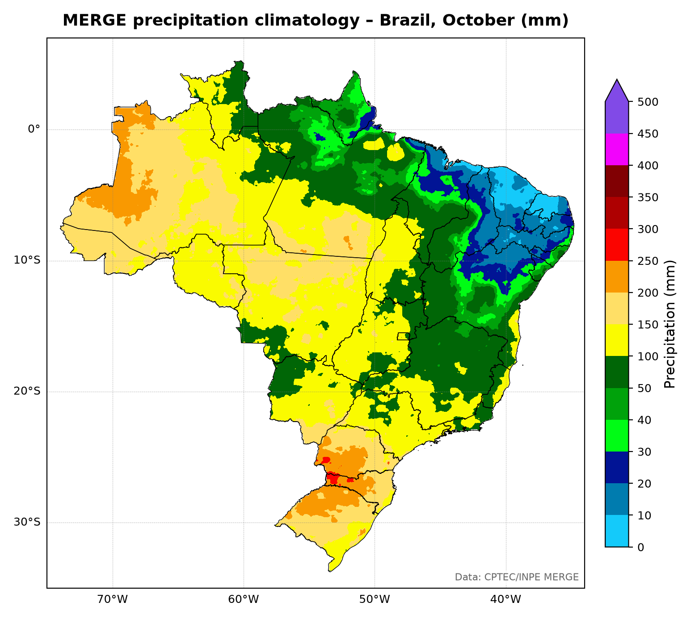

# MERGE-CPTEC

**Monthly rainfall accumulation, climatology and anomaly maps of Brazil from CPTEC/INPE MERGE satellite–gauge precipitation, with one Python command.**

[](https://github.com/valkiriaandrade/MERGE-CPTEC/actions/workflows/tests.yml)

[-green)](LICENSE)

## Gallery

| | |
|:-:|:-:|
|  |  |
| Accumulated precipitation, May 2024: the Rio Grande do Sul flood month | Precipitation anomaly, July 2024 |
|  |  |
| Accumulated precipitation, northern Brazil, July 2024 | October precipitation climatology |

## What it does

- **Accumulation**: sums the daily MERGE GRIB2 files in a folder into a period total (mm).
- **Anomaly**: subtracts the monthly climatology (`precacum`) from that total and saves it as
  NetCDF (`anomaly-netcdf`), then maps it in mm (`anomaly`) or in classes of the field's
  spatial mean ± standard deviation (`anomaly-spread`).
- **Climatology**: maps a monthly climatology file.
- Masks the maps to Brazil or to the North region (AC, AP, AM, PA, RO, RR, TO) with the IBGE
  state boundaries, and draws state borders, coastline, lat/lon labels, units and a source credit.
- Checks its inputs strictly: grids must match, GRIB units must be mm (kg m⁻²), and missing
  values propagate (days are never filled in).

## Data source

[**MERGE**](https://ftp.cptec.inpe.br/modelos/tempo/MERGE/GPM/) is CPTEC/INPE's daily
precipitation analysis for South America. It merges rain-gauge observations with GPM IMERG
satellite estimates on a 0.1° (~10 km) grid and is a standard reference for monitoring rainfall
in Brazil. See the [MERGE read-me](https://ftp.cptec.inpe.br/modelos/tempo/MERGE/GPM/READ_ME-MERGE.pdf).

*Data: CPTEC/INPE – MERGE, https://ftp.cptec.inpe.br/modelos/tempo/MERGE/ (non-commercial use;
see [LICENSE](LICENSE)).*

| File / folder in `data/` | Content | In the repo? |
|---|---|---|
| `merge_daily_may_2024/MERGE_CPTEC_202405DD.grib2` | Daily precipitation, May 2024 | 30 days committed; 10 May via `make data` |
| `merge_daily_jun_2024/MERGE_CPTEC_202406DD.grib2` | Daily precipitation, June 2024 | `make data` |
| `merge_daily_jul_2024/MERGE_CPTEC_202407DD.grib2` | Daily precipitation, July 2024 | committed sample (31 days) |
| `MERGE_CPTEC_acum_jul.nc`, `MERGE_CPTEC_acum_oct.nc` | July and October climatologies (`precacum`) | committed |
| `MERGE_CPTEC_acum_may.nc`, `MERGE_CPTEC_acum_jun.nc` | May and June climatologies | `make data` |
| `precipitation_anomaly_jul.nc`, `precipitation_anomaly_jun.nc` | Anomaly fields (mm), July and June 2024, computed from the daily files and climatology | committed; rebuilt by `make figures` |
| `BR_UF_2022/BR_UF_2022.zip` | IBGE 2022 state boundaries (zipped shapefile) | committed |

## Get the data

Raw files that are not committed are downloaded from the public CPTEC/INPE server:

```bash
make data                          # or: python scripts/download_data.py
```

This fetches exactly what the README examples and `make figures` need (daily GRIB2 files for
May, June and July 2024 and their monthly climatologies, plus the October climatology), skipping
files that are already there. To download other periods:

```bash
python scripts/download_data.py --months 2024-08 2024-09   # daily files + climatologies
python scripts/download_data.py --climatology jan feb      # climatologies only
python scripts/download_data.py --dry-run                  # only list the URLs
```

Downloaded files are git-ignored. A file missing on the server is reported by name, and the
script exits with an error after trying the rest. `make figures` refuses to build an
accumulation from an incomplete month and asks you to run `make data`.

`make figures` first recomputes the two anomaly NetCDF files from the daily files and the
monthly climatology (`merge-cptec --product anomaly-netcdf`), so the anomaly maps always follow
the raw data. Without those inputs it keeps the committed copies.

> The raw MERGE files committed here are the current (reprocessed) server versions, the same
> files `make data` downloads. See [docs/VALIDATION.md](docs/VALIDATION.md).

## Install

Python 3.10 or later. GRIB2 files are read with [ecCodes](https://github.com/ecmwf/eccodes-python),
which installs from pip with its binaries on Windows, Linux and macOS.

```bash
git clone https://github.com/valkiriaandrade/MERGE-CPTEC.git
cd MERGE-CPTEC
python -m venv .venv
source .venv/bin/activate          # Windows PowerShell: .venv\Scripts\Activate.ps1
python -m pip install -e ".[dev]"  # or: make install
```

## Quick start

```bash
make data                          # fetch the raw files that are not committed
SHP=data/BR_UF_2022/BR_UF_2022.zip

# May 2024 accumulated precipitation over Brazil
merge-cptec --product accumulation --input data/merge_daily_may_2024 \
            --shapefile $SHP --output output/accumulation_may_2024.png

# July 2024 accumulation for northern Brazil
merge-cptec --product accumulation --region north --input data/merge_daily_jul_2024 \
            --shapefile $SHP --output output/accumulation_jul_2024_north.png

# July 2024 anomaly: compute the NetCDF, then map it
merge-cptec --product anomaly-netcdf --input data/merge_daily_jul_2024 \
            --climatology data/MERGE_CPTEC_acum_jul.nc --output output/anomaly_jul_2024.nc
merge-cptec --product anomaly --input output/anomaly_jul_2024.nc --period "July 2024" \
            --shapefile $SHP --output output/anomaly_jul_2024.png

# Rebuild every figure in figures/
make figures                       # or: python scripts/make_figures.py
```

## CLI options

`merge-cptec --help` prints the full list.

| Option | Default | Description |
|---|---|---|
| `--product` | `accumulation` | `accumulation`, `anomaly-netcdf`, `anomaly`, `anomaly-spread` or `climatology` |
| `--input PATH` | *required* | Folder of daily GRIB2 files (`accumulation`, `anomaly-netcdf`) or a NetCDF file (other products) |
| `--output FILE` | *required* | Output PNG (or NetCDF for `anomaly-netcdf`); folders are created |
| `--climatology FILE` | – | `precacum` climatology NetCDF, required by `anomaly-netcdf` |
| `--region {brazil,north}` | `brazil` | Map domain; the Portuguese aliases `brasil` and `norte` are also accepted |
| `--shapefile FILE` | – | State boundaries with a CRS, as `.shp` or zipped, for masking and borders (required by `anomaly-spread`); without it, Natural Earth borders are used |
| `--period TEXT` | from file names | Period shown in the title, e.g. `"May 2024"` |
| `--title TEXT` | built from the data | Custom map title |
| `--dpi N` | `200` | PNG resolution |
| `--verbose` | off | Debug logging and full tracebacks |

The `scripts/` folder has shortcuts that preset `--product` (and `--region`):
`monthly_accumulation.py`, `monthly_accumulation_north.py`, `make_anomaly_netcdf.py`,
`anomaly_mm.py`, `anomaly_spread.py` and `climatology.py`.

## Project structure

```
MERGE-CPTEC/
├── data/                  # sample MERGE inputs, IBGE boundaries; `make data` adds the rest
├── figures/               # published maps (rebuilt with `make figures`)
├── scripts/
│   ├── download_data.py   # downloads raw data from CPTEC/INPE (`make data`)
│   ├── make_figures.py    # regenerates every figure in figures/
│   └── *.py               # shortcuts for the CLI
├── src/merge_cptec/
│   ├── cli.py             # command-line interface
│   ├── processing.py      # accumulation and anomaly
│   ├── io.py              # GRIB2/NetCDF reading and grid checks
│   ├── plotting.py        # shared map style and rendering
│   ├── labels.py          # titles, periods and unit labels
│   └── regions.py         # map domains and region aliases
├── tests/                 # pytest suite (synthetic data + one real GRIB2 file)
├── docs/                  # validation notes and project history
├── Makefile
└── pyproject.toml
```

## Development

```bash
make install   # editable install with dev tools + pre-commit hooks (ruff)
make test      # pytest with coverage report
make lint      # ruff check + ruff format --check
make data      # download the raw data from CPTEC/INPE (manual step, never run in CI)
make figures   # regenerate every figure in figures/ from data/
```

On Windows without `make`, run the commands from the [Makefile](Makefile) directly, e.g.
`python -m pytest -q --cov` or `python scripts/make_figures.py`.

Tests and CI never download anything: they use small files committed in the repo, and a test
fixture blocks network access. `make data` is a manual step.

## License

Code: [MIT](LICENSE) © Valkiria Andrade.
MERGE data: CPTEC/INPE, non-commercial use only; see [LICENSE](LICENSE) and the
[MERGE read-me](https://ftp.cptec.inpe.br/modelos/tempo/MERGE/GPM/READ_ME-MERGE.pdf).

---

Project history: [original README](docs/README-original.md).
