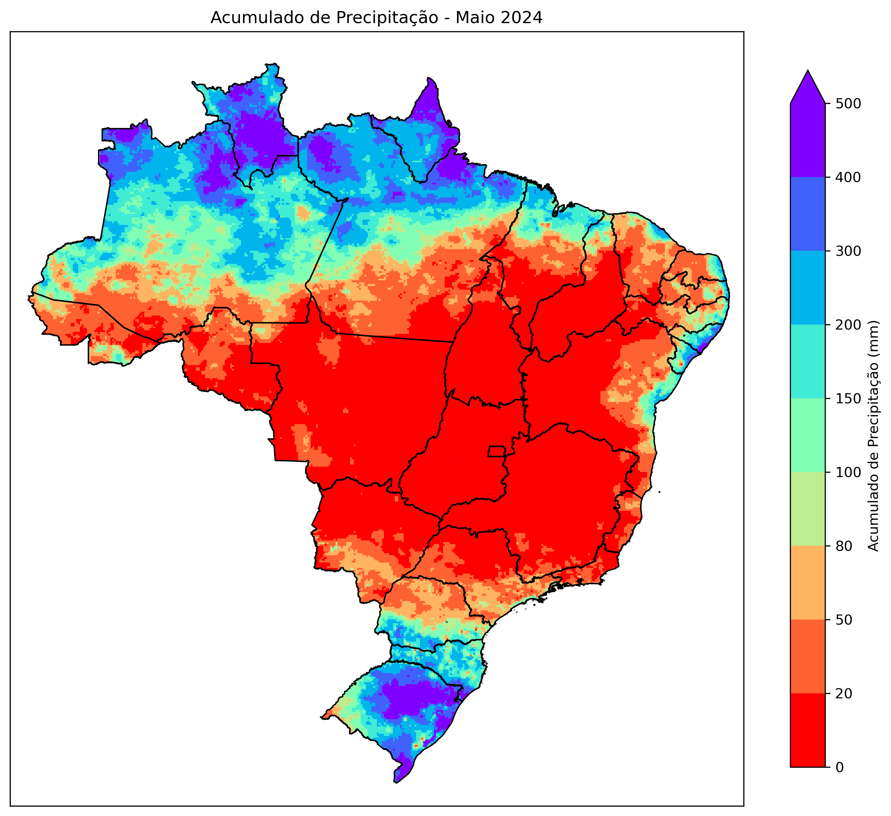
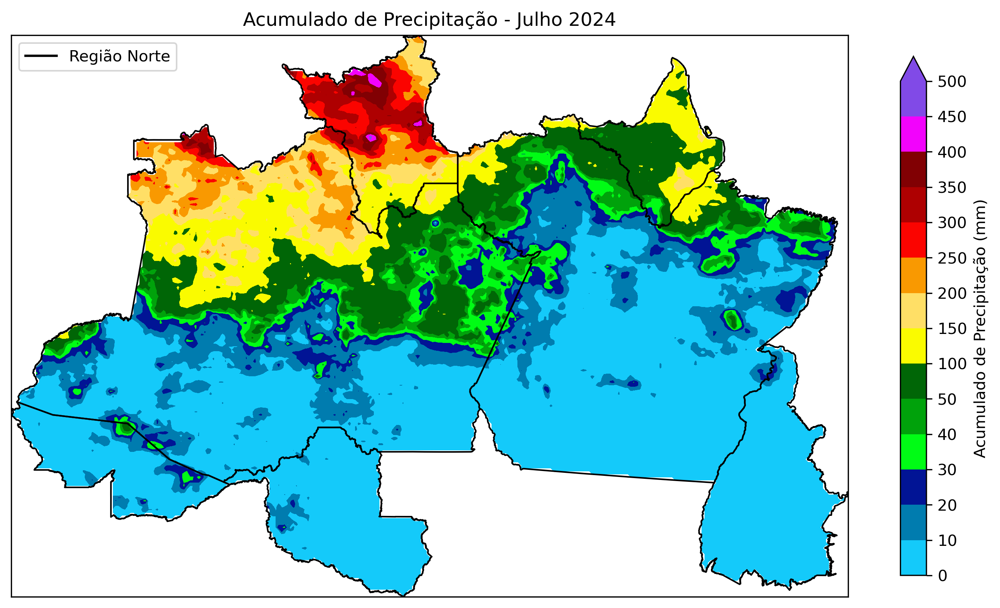
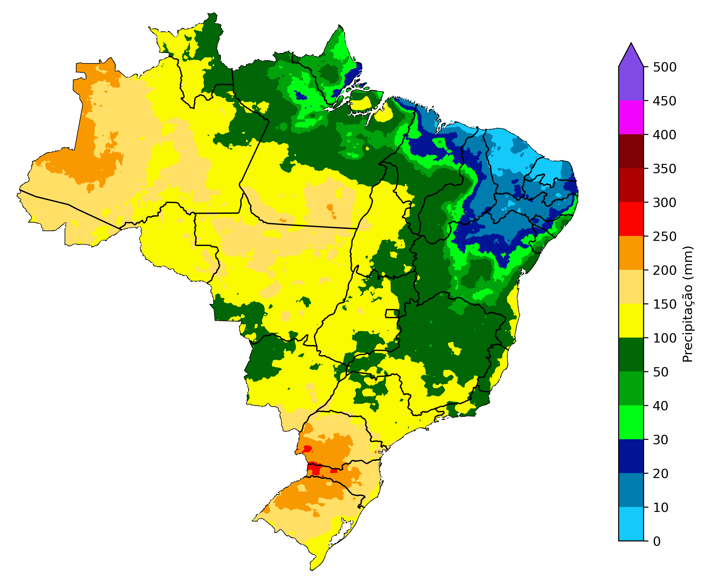
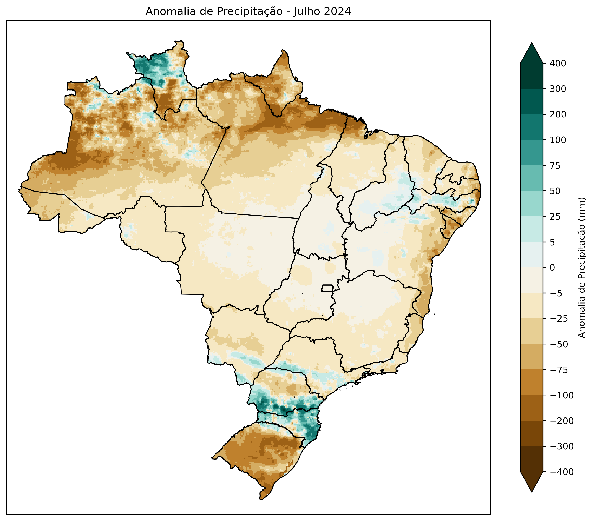
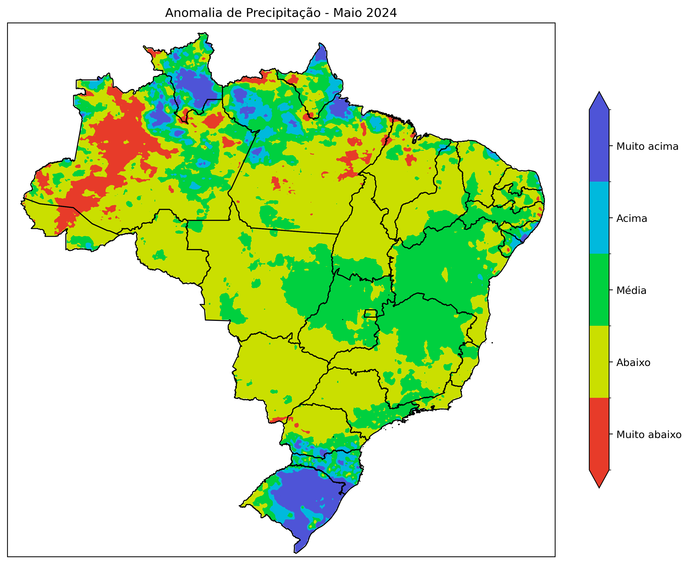

# MERGE-CPTEC

This repository contains scripts for visualising precipitation data from INPE/CPTEC's MERGE product. MERGE combines precipitation observations from several sources, such as satellites and rain gauges, to create a dataset with high spatial and temporal resolution.

## Description

The MERGE-CPTEC project focuses on visualising precipitation data using CPTEC/INPE's MERGE product.

## Repository structure

- `Scripts/`: scripts used to process and analyse the data.
- `Dados/`: raw and processed data.
- `Figuras/`: figures generated from the data.

## Prerequisites

Before running the scripts, you will need to install the following Python libraries:

- numpy
- geopandas
- matplotlib
- pygrib
- cartopy
- xarray
- netCDF4

## Images

### Figure 1: Example of monthly accumulated precipitation



### Figure 2: Example of monthly accumulated precipitation - North region



### Figure 3: Example of climatology - October



### Figure 4: Example of monthly precipitation anomaly in mm



### Figure 5: Example of monthly precipitation anomaly in standard deviations



## How to use

1. Clone this repository:
    ```bash
    git clone https://github.com/valkiriaandrade/MERGE-CPTEC.git
    ```

2. Go to the project folder:
    ```bash
    cd MERGE-CPTEC
    ```

3. Run the scripts as needed.

## Contributing

Contributions are welcome! Feel free to open issues and pull requests.

## License

This project is licensed under the MIT License. See the [LICENSE](../LICENSE) file for details.
